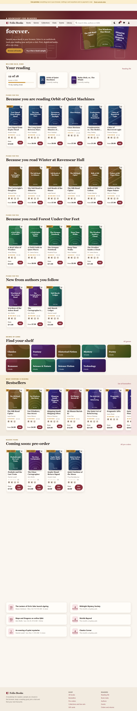
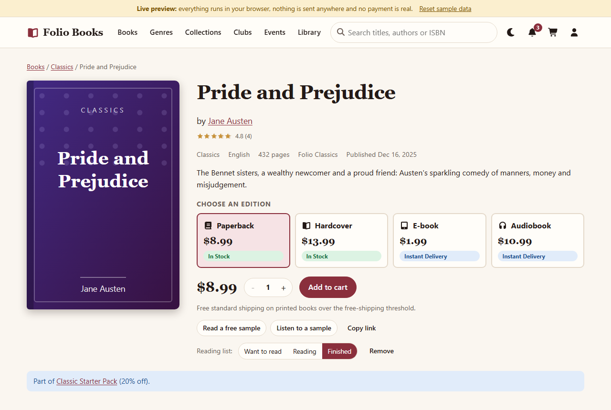
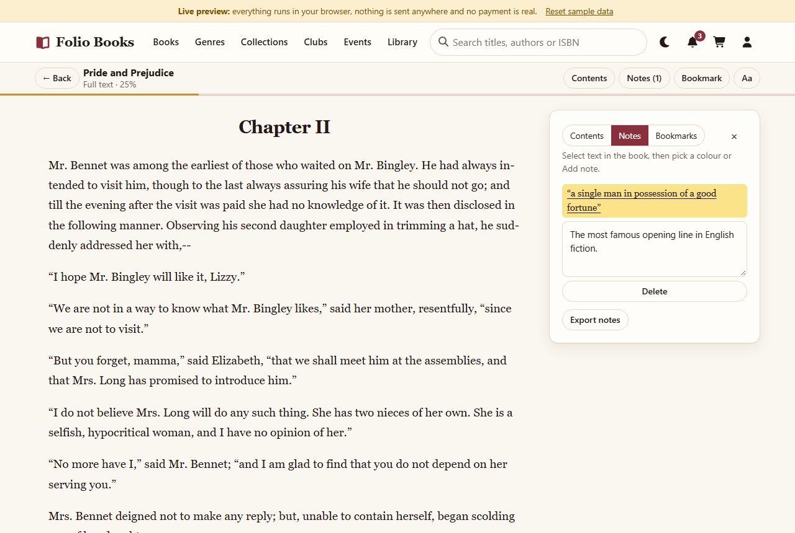
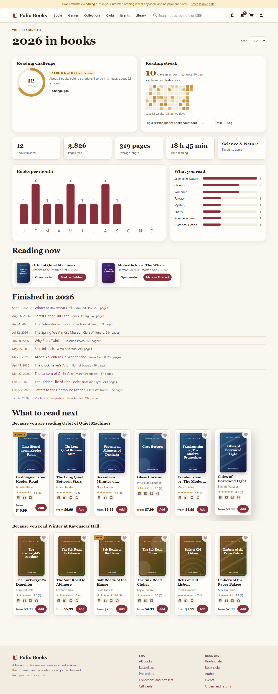
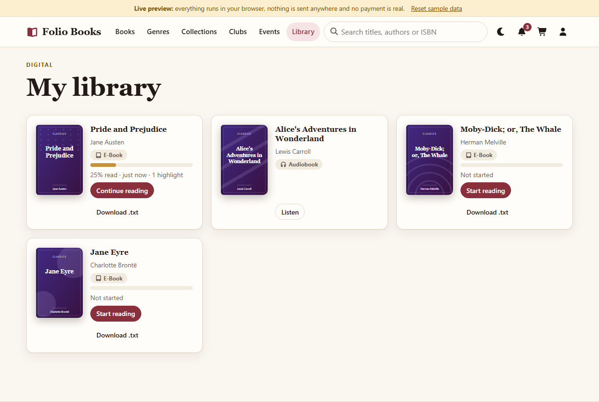
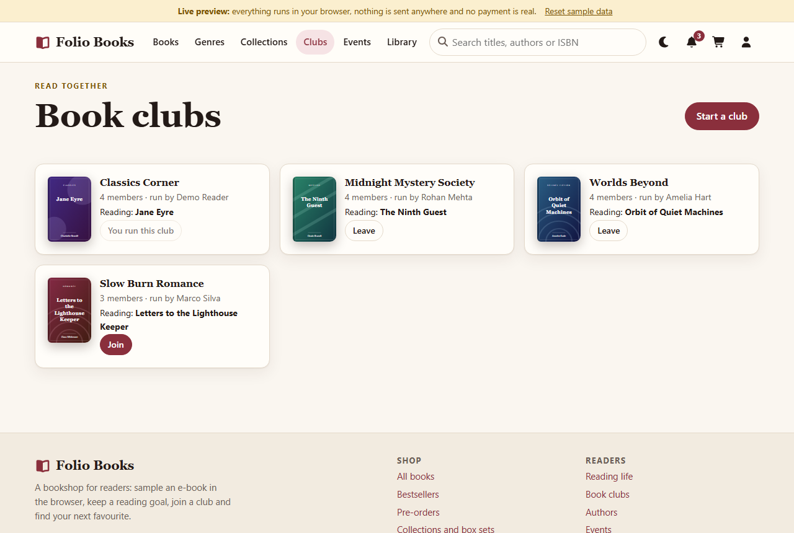
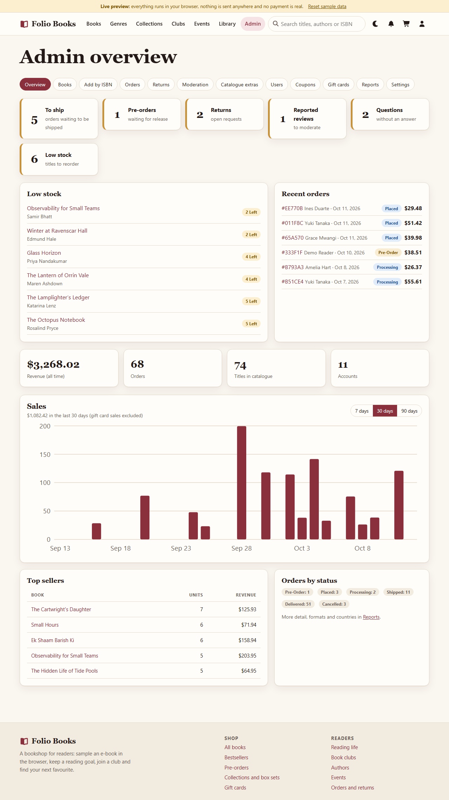
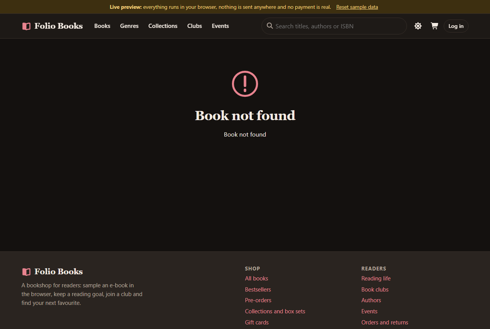

# Folio Books (Bookstore E-commerce)

A full-stack online bookstore built around **books and readers**: React 19 + Vite frontend, Express 5 + MongoDB backend, optional Stripe test-mode payments (with a labelled mock fallback), an in-browser e-book reader and audiobook player, reading goals, book clubs and a role-based back office.

**Live preview (browser-only, no backend, no real payments): https://shishir19999.github.io/Bookstore-Ecommerce-App/**

Requires Node.js 24 LTS (Docker images: node:24, nginx:1.30, mongo:8.0).



## What is in the shop

**For readers**
- **Four editions per book**: paperback, hardcover, e-book and audiobook, each with its own price, ISBN and (for printed books) stock. Compare editions side by side.
- **In-browser e-book reader**: free sample of every e-book (full text for owners), font size, typeface, line spacing, paper/sepia/night themes, progress saved, bookmarks, colour highlights with notes, notes export. Six public-domain classics (Austen, Carroll, Conan Doyle, Brontë, Melville, Shelley) ship with real text from Project Gutenberg; other titles use generated sample text.
- **Audiobook player**: narrated by the browser's text-to-speech (speed, voice, sleep timer, chapter list). No audio files are shipped.
- **Digital library** for purchased e-books and audiobooks, with progress and a plain-text download.
- **Reading life**: yearly goal with a progress ring and pace ("2 books behind"), reading streaks, a 12-week activity heat map, books per month, genre breakdown, session logging for paper books, and "because you read" recommendations.
- Reading list (want / reading / finished with dates) with **wish list sharing by link**.
- **Series, collections and box sets** (box-set discount applies when the whole set is in the cart), pre-orders with release dates, back-in-stock alerts, recently viewed.
- **Reviews** with helpful votes, spoiler tags, verified-purchase badges and reporting; **Q&A** on every book.
- **Authors** with bios, follow, and **events** (RSVP, calendar download). Followers are notified of new books and events.
- **Book clubs**: create/join, monthly pick, discussion threads with spoiler tags, **live updates** (Socket.IO in real mode, BroadcastChannel between tabs in the live preview).
- Search with **autocomplete and typo tolerance** ("lantrn orrin" finds *The Lantern of Orrin Vale*), ISBN search and "did you mean".
- Notifications (orders, stock, authors, clubs, returns), dark mode, parallax landing page, responsive from 320px, keyboard friendly and axe-checked.

**Buying**
- Cart with free-shipping progress, coupons, **gift cards** (buy and redeem, instant code), **loyalty points** (earn, redeem, Bronze/Silver/Gold with bonus points and free shipping at Gold), gift wrapping and gift message.
- Multi-step checkout with country-aware **shipping and tax** (printed books and digital goods can be taxed differently), standard/express delivery, stock enforced server-side.
- Orders with tracking, reorder, cancel, **printable invoices**, **returns and refund requests** (window configurable) with status tracking.

**Back office** (see roles below): inventory with per-edition stock adjustments and an audit trail, **ISBN lookup/import from Open Library** (no key, graceful offline fallback) and quick add / receive stock, order management with packing slips, returns desk, review and Q&A moderation, authors/events/collections/box sets/series editors, user and role management, coupons, gift cards, reports and **CSV exports**, store settings (shipping, tax table, loyalty, return window).

## Roles

| Role | Can do |
| --- | --- |
| Customer | Shop, read, listen, review, ask questions, clubs, returns, rewards, gift cards |
| Staff | Everything above plus: books and stock, ISBN import, orders and packing slips, returns, moderation, events, authors, collections, box sets, series blurbs, CSV exports of orders/inventory/returns |
| Admin | Everything staff can, plus: users and roles (create staff, disable accounts, adjust points), coupons, gift cards, reports and sales/customer exports, store settings, deleting books |

Role checks run in the server on every route; registration always creates a customer.

## One engine, two modes

All `/api` routes are implemented **once**, in `Backend/shared/engine.mjs` and its modules. Express serves them over MongoDB; the live preview runs the *same code* in the browser over an in-memory store persisted to localStorage. Rules (pricing, shipping, tax, coupons, loyalty, search, reading stats, seed data) live in `Backend/shared` and are copied byte-for-byte into `Frontend/src/shared` (`npm run sync:shared` in `Backend`). Tests fail if the copies drift (`tests/shared.test.js`) and a parity test runs the same scripted session against Express+MongoDB and the in-browser engine and compares the responses (`tests/parity.test.js`).

## Run it

### Full-stack mode (real API, Stripe test mode or mock payments)

1. `npm install` in the root, `Backend` and `Frontend`.
2. Copy `Backend/.env.example` to `Backend/.env` and set `PORT`, `MONGO_URI` and `JWT_SECRET` (required). Copy `Frontend/.env.example` to `Frontend/.env` (`VITE_API_URL`).
3. Start MongoDB, then `npm start` in the root (backend and frontend together), or `npm run dev` in `Backend` and `Frontend` separately.
4. On an empty database the server loads the sample catalogue (books, authors, series, box sets, collections, events) automatically. For the full sample world (accounts, orders, reviews, clubs, reading history) run `npm run seed` in `Backend` on an empty database (`--reset` is only allowed on databases named `bk_*` unless you add `--i-know-this-deletes-data`).

Sample logins after `npm run seed` (password `Password123!`, sample data only): `user@example.com` (customer), `staff@example.com` (staff), `admin@example.com` (admin); sample gift card `FOLI-OREA-DER5-2026`. Without seeding, set `ADMIN_PASSWORD` once and the first admin `ADMIN_EMAIL` is created on start-up; promote staff from Admin > Users.

### Browser-only live preview

```
cd Frontend
npm run dev:demo      # local preview with hot reload
npm run build:pages   # static build in Frontend/dist, base /Bookstore-Ecommerce-App/, hash routing
```

The preview seeds 74 books, 11 accounts, 70 orders and a full reading history on first visit; everything stays in your browser (**Reset sample data** in the banner restores it). Sample logins are on the login screen (Customer, Staff, Admin; password `Password123!`). Coupons: `WELCOME10` (10%), `READMORE5` ($5 off $30+), `BOXSET5` ($5 off $50+). Gift card `FOLI-OREA-DER5-2026` ($25). Publish the contents of `Frontend/dist` to GitHub Pages.

Wish-list links in the preview only work in the same browser (the data lives there); in real mode they work anywhere.

## API overview

All routes are JSON under `/api` (errors: `{ "error": "message" }`). Main groups:

| Area | Paths |
| --- | --- |
| Auth | `POST /auth/register`, `/auth/login`, `/auth/logout`, `GET /auth/me`, `PUT /me/profile` |
| Catalogue | `GET /books` (search, filters, formats, series, pre-order), `/books/suggest`, `/books/featured`, `/books/:id`, `/books/:id/extras`, `/books/:id/related`, `/books/:id/text`, reviews, questions, `POST /books/:id/notify` |
| Discover | `/series`, `/collections`, `/bundles`, `/authors`, `/events`, `/clubs` (+ threads and posts) |
| Reader | `/me/reading-list`, `/me/goal`, `/me/stats`, `/me/activity`, `/me/reader/:bookId`, `/me/library`, `/me/recommendations`, `/me/notifications`, `/me/wishlist/share`, `/shared/wishlist/:token` |
| Shop | `POST /checkout/quote`, `/payments/checkout`, `/payments/webhook`, `/orders/...` (mine, detail, cancel, reorder, returns), `/me/giftcards`, `/me/loyalty`, `/coupons/validate` |
| Staff | `/staff/overview`, `/staff/inventory`, `/staff/isbn/:isbn`, `/staff/quick-add`, `/staff/returns`, `/staff/reviews`, `/staff/questions`, `/staff/events|collections|bundles|authors|series`, `/admin/orders`, `PATCH /books/:id/stock`, `/export/:name.csv` |
| Admin | `/admin/users`, `/admin/settings`, `/admin/coupons`, `/admin/giftcards`, `/admin/stats`, `/admin/reports` |

Prices, discounts, shipping, tax and points are always computed on the server from the database.

## Payments (Stripe test mode)

Set in `Backend/.env`: `STRIPE_SECRET_KEY` (`sk_test_...`), `STRIPE_WEBHOOK_SECRET` (`whsec_...`) and `FRONTEND_URL`. Forward webhooks locally with `stripe listen --forward-to localhost:5000/api/payments/webhook` and pay with test card 4242 4242 4242 4242. Shipping, tax and discounts are sent to Stripe as line items and one discount. Without a key the labelled mock path is used. Orders paid in full by gift card or points skip Stripe. Stripe is unit-tested with a mocked client only; refunds are recorded in the shop but must be issued in the Stripe dashboard. There is no e-mail sending: notifications are in-app.

## Tests and checks

- `npm test` in `Backend`: 46 tests (node:test + supertest) on a throwaway MongoDB database named `bk_test_*` that is dropped afterwards: shared rules, drift guard, parity with the preview engine, core API, features.
- `npm run lint` and `npm run build` in `Frontend`; `npm run build:pages` for the preview.
- Browser checks (Playwright + axe) were run per role on desktop and phone against the live preview and a real-mode build.

## Screenshots

| | |
| --- | --- |
|  |  |
|  |  |
|  |  |
|  |  |

## Deploy with Docker

```
export JWT_SECRET=$(openssl rand -hex 32)      # required
# optional: ADMIN_PASSWORD, STRIPE_SECRET_KEY, STRIPE_WEBHOOK_SECRET, FRONTEND_URL, VITE_API_URL
docker compose up --build
```

Frontend (nginx) on http://localhost:8080, API on http://localhost:5000, MongoDB data in the `mongo-data` volume, uploaded covers in the `uploads` volume. `VITE_API_URL` is baked in at build time. In production, terminate TLS in front and restrict CORS. The seed script uses only the shared sample data and needs no dev dependencies.

## Notes

- Book search keeps the catalogue in memory per request, which is fine for thousands of titles; use Atlas Search or a search service for much larger catalogues.
- Sample titles, authors and reviews are fictional. Public-domain texts: Project Gutenberg.
